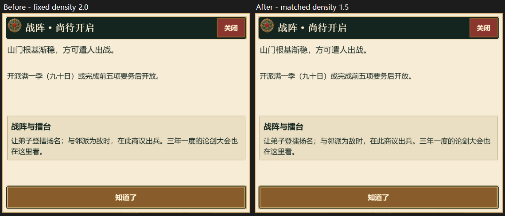

# 原生富文本清晰度 · Native paragraph clarity

## 现象及真实对照 · Observation and matched captures

实际 Windows RTX 5090 Laptop/Chrome 157，1280×800 CSS、DPR1、UI 画布 backing1920×1200。在新开游戏后按正常入口打开尚待开启的战阵弹窗。固定 density2 的三段正文使用原生 ParagraphNode 独立位图，却在实际1.5 backing pixels/UI unit 下由 nearest 执行1.333倍重新缩放；相邻普通单行、标题及按钮使用原生字形路径。 · Native multiline raster mismatch, not a low-resolution illustration.

图为左右相同560×454原像素区域，没有缩放插值。独立四组同屏 A/B：2 nearest、2 linear、匹配1.5 nearest、匹配1.5 linear。最后的匹配 nearest 轮廓最清晰；不采用全局线性过滤，匹配时会轻微柔化。 · Compare actual crops, not a mockup.

| Measure | Before | After |
|---|---:|---:|
| Native paragraph density (this desktop) | 2 | 1.5 |
| Raster/backing ratio | 1.333 | 1.000 |
| Sum of three actual paragraph bitmap bytes | 541424 | 315484 |
| Actual layout | unchanged | unchanged |

## 实现及边界 · Implementation

[`src/ui/native-kit.mjs`](../src/ui/native-kit.mjs) 的 `createParagraphDensity` 用真实 browser.frame 尺寸和 canvas backing、uiScale 计算独立段落请求，稳定误差处理和精度，保持原 density 最大2；未完成底层 resize 时使用上一已确认值，避免瞬时变化。[`src/ui/native-shell.mjs`](../src/ui/native-shell.mjs) 以原生描述编译入口传入。无 HTML 文本替代、无 vendor 补丁、无全局纹理 filter 改动。 · Adapt existing public `paragraph.density`, bound native image budget and preserve existing sampling.

实际桌面窗口1280×800→1100×700→390×844→1280×800，density1.5→1.745→2(cap)→1.5，保持打开的同一 modal 和游戏状态、无溢出/运行错误。DPR1.25/2另核实实际 backing；不保证所有外部浏览器缩放或物理显示器都达到原像素。

实际 Fold7 低档411×813/DPR2.625 的同一锁战阵竖屏弹窗两行正文、详情和标题像素完全一致（旧/新都取密度2）；该设备不宣称新增文字改善。保持既有最高密度避免额外贴图预算。 · No change where the previous density already matches the active backing.

段落 fontWeight 是独立明确能力边界：正式 `ViewParagraphStyle` 只支持 fontFamilies、lineHeight、locale、direction、maxLines、density；单行标题和按钮有 weight。原生 paragraph 的请求/缓存/Canvas/CanvasKit 缺完整字重契约，不用虚假字体族绕过；参见 ENGINE-NOTES #12。 · Weight is a separate documented engine gap, not repaired by the density change.

## 验收 · Acceptance

专项 Node测试5/5含先红后绿，原浏览器17画面/旧档通过，标题黄金0.13828125%、传承0.3400390625%实际差值（正文改变，仍原阈值内），未改黄金图。Fold7完整低档48/48及高档冷/暖18/18无运行错误；PC 和手机性能的专项实测另见 QUALITY 与 [fold7-high-program-preparation.md](fold7-high-program-preparation.md)。
