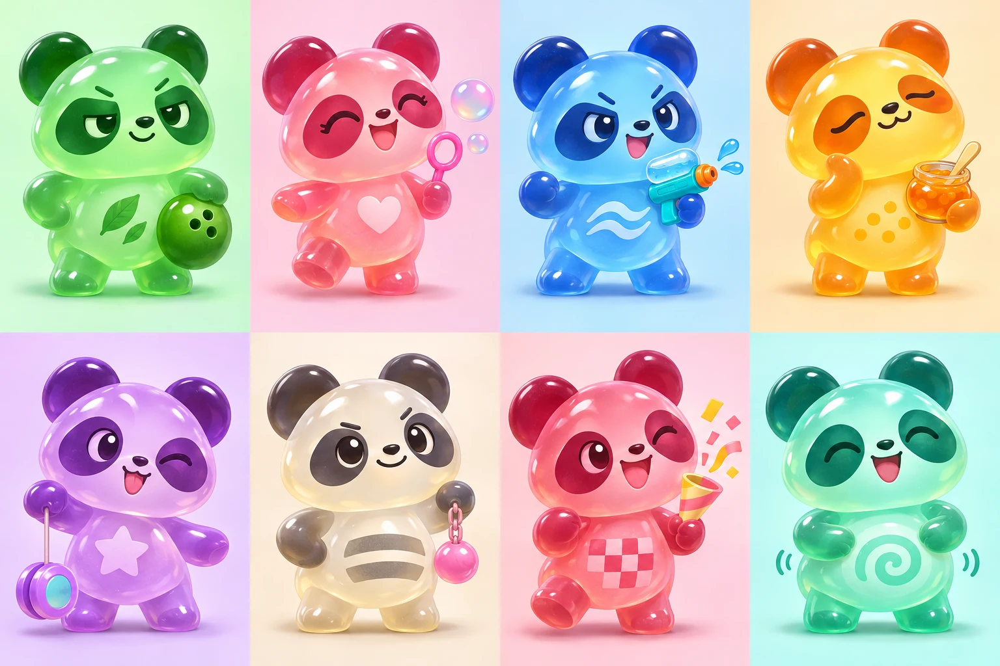

# 果冻熊猫角色设计 · Jelly Pandas character designs

## 角色和玩具 · Cast and starter toys

图里从左到右先读上排，再读下排。每只熊猫的眼斑、腹纹和起始玩具在选角时都能看到。战斗模型保留圆耳、短肢和半透明果冻质感。

Read left to right, top row first. The eye patches, belly stamps and starter toys identify the eight pandas in the picker. The 3D models use rounded ears, short limbs and translucent jelly.

| 角色 · Panda | 识别特征 · Character cues | 初始玩具 · Starter toy |
|---|---|---|
| 青竹 · Bamboo | 浅绿果冻和深绿叶印，眼神沉着 · Leaf-green jelly, dark leaf stamp, steady gaze | 竹筒保龄 · Bamboo Bowler |
| 蜜桃 · Peach | 桃粉果冻和爱心，笑起来眼睛眯成弧形 · Peach-pink jelly, heart stamp, arched grin | 泡泡棒 · Bubble Wand |
| 海盐 · Ocean | 蓝莓色眼斑、外张圆耳和波浪 · Blueberry patches, outward ears and a wave stamp | 果冻水枪 · Jelly Hose |
| 芒果 · Mango | 蜂蜜色圆肚、果粒圆点和放松的眼神 · Rounded honey-yellow belly, dots and relaxed eyes | 果酱投手 · Jam Lobber |
| 葡萄 · Grape | 浅紫果冻、高耳朵和星形腹纹，静止时会眨单眼 · Lilac jelly, high ears, star stamp and an idle wink | 悠悠球 · Yo-yo |
| 经典 · Classic | 香草白果冻、炭色眼斑、大眼睛和横条纹 · Ivory jelly, charcoal patches, wide eyes and stripes | 口香糖流星锤 · Gumball Flail |
| 樱桃 · Cherry | 珊瑚红、酒红眼斑和方格印，眨另一只眼 · Coral jelly, wine-red patches, checks and a wink on the other side | 彩纸礼炮 · Confetti Cannon |
| 薄荷 · Mint | 清凉青色、开口笑、大肚子上的旋涡 · Cool mint jelly, open smile and a belly swirl | 肚皮鼓 · Belly Drum |

## 游戏里的用法 · In-game use

- 选角卡和队伍栏取同一张图的头部。选中角色后，图鉴条展示全身和一句可直接尝试的打法。玩具出手沿用战斗里的实际特效。
- 从背后看熊猫是常态，3D 背面加淡色同形印记。跑动和落地仍由已有的果冻形变控制，轮廓差异用耳朵、眼睛和身体比例取得。
- 设计稿使用生成式绘图创作。游戏用一张 1536 × 1024 WebP，在界面上裁切对应区域。

- The picker and party use the same head crops. The selected panda also shows full-body art and a practical starter-toy tip. Toys use their normal combat effects in play.
- The chase camera usually sees the panda from behind, so the 3D models carry a faded version of their stamp on the back. The existing jelly rig drives movement and landings. Ear, eye and body proportions shape each silhouette.
- This original concept atlas was made with generative illustration. The interface uses regions of one 1536 × 1024 WebP.

## 果冻动作 · Jelly motion

| 动作 · Move | 画面表现 · On-screen motion |
|---|---|
| 跑动和转向 · Run and turn | 随步点压缩，转弯时侧倾，头和耳朵稍后跟上 · Squash on footfalls, bank into turns, and let the head and ears follow |
| 蓄力和起跳 · Charge and takeoff | 蓄力时压低，离地后立刻拉长 · Crouch into the charge and stretch on release |
| 落地和下砸 · Land and slam | 触地先压扁，然后回弹，落差和下砸决定幅度 · Compress on contact, then rebound, with more travel after a hard fall or slam |
| 受击和翻滚 · Hit and roll | 朝远离撞击的方向偏斜，短暂发光后恢复。翻滚时收紧，停下后沿最短路径回正 · Bend away from impact and fade back to the usual glow. Tuck during a roll and use the shortest rotation back to upright |

变形只作用在视觉模型上。角色碰撞、动作时机和攻击数值沿用游戏规则。

Deformation lives in the visual rig. Collision, move timing and attack values follow the game rules.
